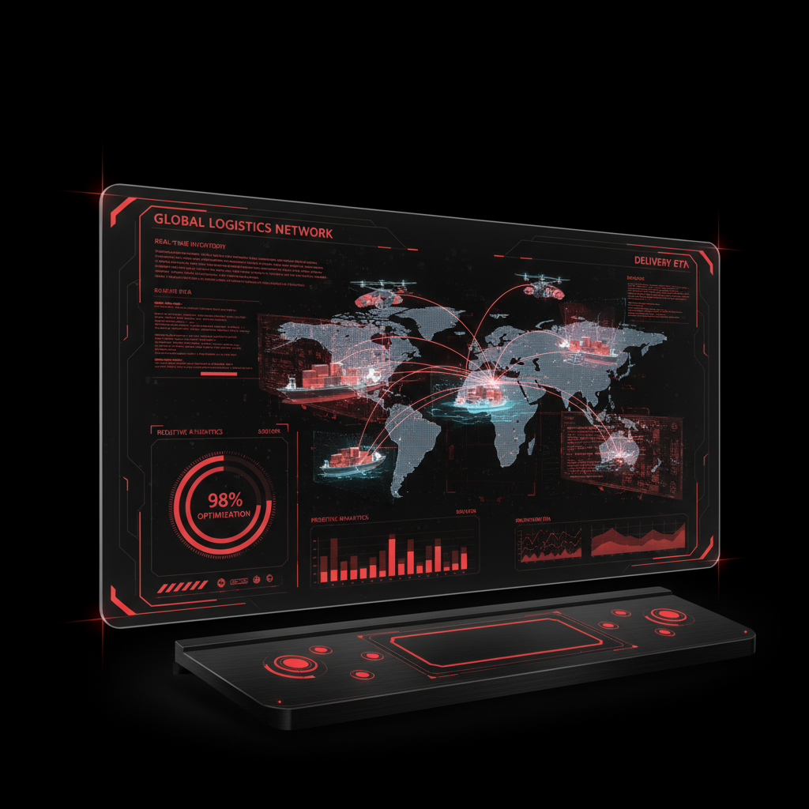

# Supply-Chain-AI

A hackathon prototype source bundle exploring inventory, supplier, and route-management dashboards with AI-assisted workflows.

## Contribution

Debayan Lahiry handled the technical implementation. Teammates contributed research and presentations. [Debayan's portfolio](https://debayan-cyberx.github.io/Deb-s-Portfolio.github.io/).

## Explore the project

The root contains the HTML/CSS/JavaScript interface, visual assets, and backend implementation notes. Existing captures are available in [dashboard_ui.png](dashboard_ui.png) and [network_3d.png](network_3d.png).

## Walkthrough

1. Review the sample inventory and supplier views in the interface.
2. Inspect the route and risk visualizations and their example data.
3. Read the backend notes to follow the intended API and WebSocket flow.
4. Distinguish demonstration metrics and AI suggestions from measured operational results.

## Current setup boundary

This repository needs setup cleanup before it can be treated as a reproducible full-stack application. The committed `server.js` includes Markdown headings and a fenced JavaScript listing; it is not directly executable with Node.js as committed. `package.json` provides scripts but does not declare the backend's dependencies. The existing [setup guide](complete-setup-guide.md) describes a target layout that differs from the current root layout.

For an interface-only preview, serve the repository root with `python -m http.server 8000` and open `http://localhost:8000/`. This does not verify backend connectivity or AI behavior. To run the backend, first extract its JavaScript listing into a valid source file, declare its imported dependencies, configure your own credentials, and reconcile the frontend's API paths. Those runtime changes are outside this documentation update.

## Limitations and validation

Sample stock values, predictions, savings, and accuracy figures are demonstration data, not validated business outcomes. Autonomous purchasing, real supplier negotiations, and production routing are not established by this source bundle. No reproducible backend test run or deployed service is claimed here.
